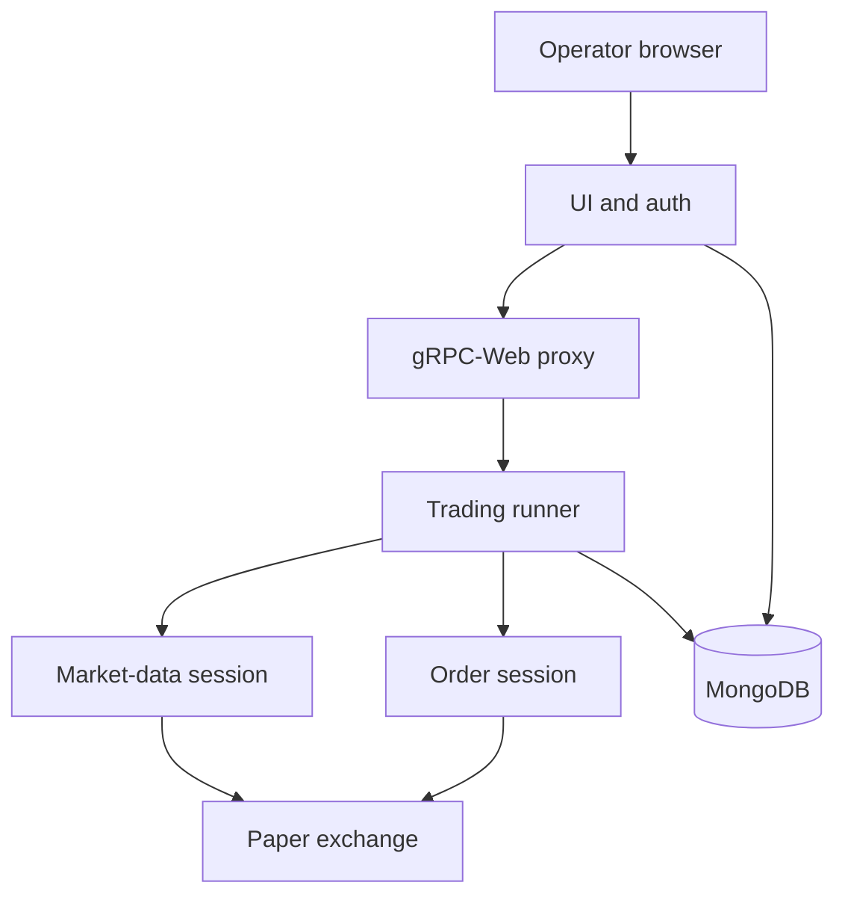
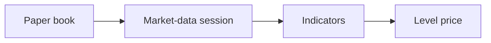
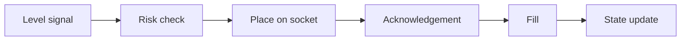
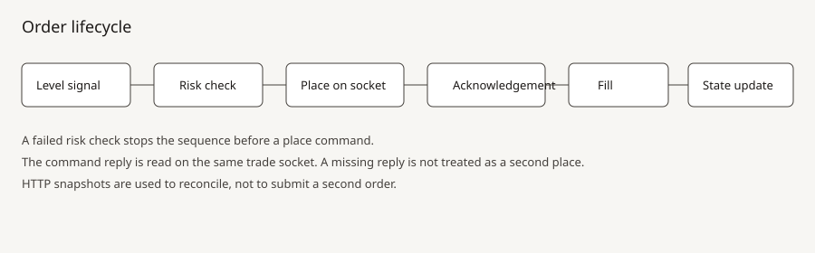
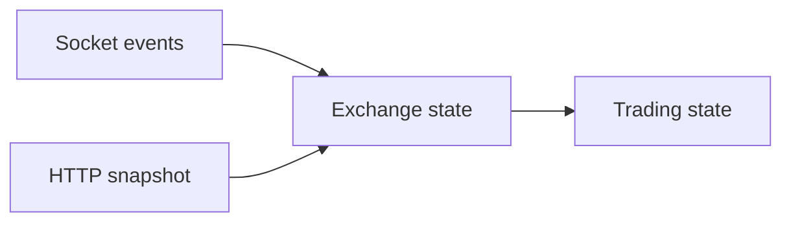
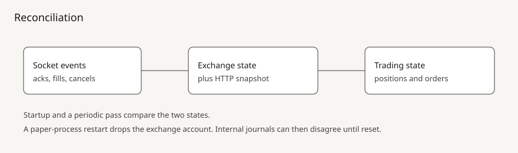
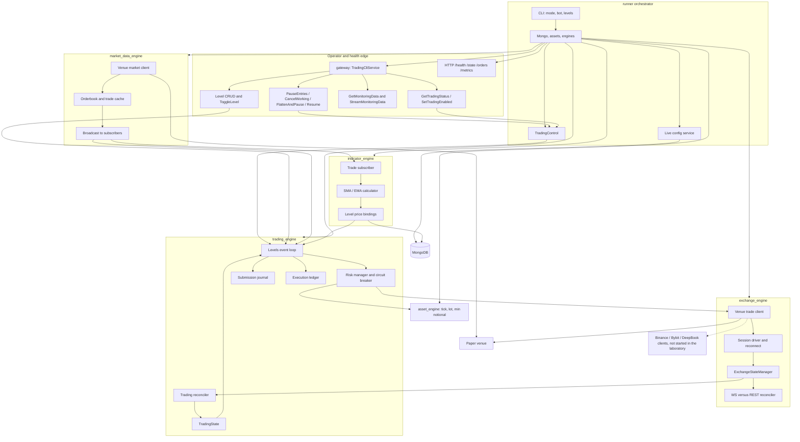
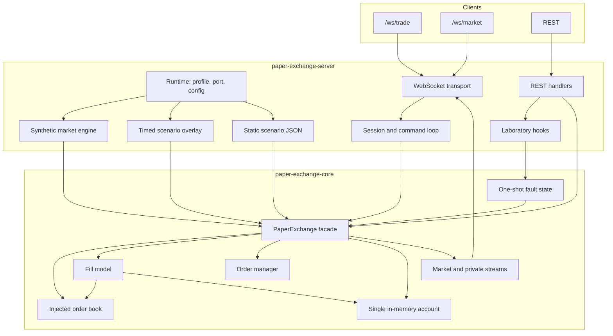
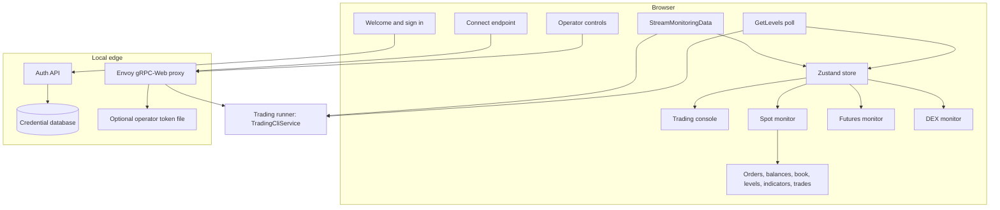

# Trading System

A modular trading runtime written in Rust. It ingests market data, keeps exchange and internal state, applies risk checks, and submits orders through an exchange client. A separate paper exchange supplies the market and the order acknowledgements. A browser UI watches and controls the runtime over gRPC.

This repository holds ecosystem documentation, architecture diagrams, and presentation
materials for the trading laboratory. It is licensed under the Apache License 2.0
(see [LICENSE](LICENSE) and [NOTICE](NOTICE)). Copyright © 2026 T.L.P. Arc Entertainment Ltd.

Implementation source lives in sibling repositories (`trading_system`, `k-paper`,
`trading-system-ui`). A coordinated public release of those components is in preparation
via a reviewed export; this showcase does not currently ship runtime binaries or Compose.

The system is a working research and laboratory codebase. It is not production complete
and it is not mainnet ready. This write-up does not claim a latency budget, a production
deployment, or a profitable strategy.

## Problem

An automated trader has to treat market data, order commands, and operator control as different paths, and it has to stay consistent when an acknowledgement is late or a socket drops. Doing that only against a live exchange makes failures expensive and hard to repeat. The laboratory path runs the same runner against a local paper exchange.

## Architecture

The live engines share one process and pass events on in-process channels. The browser does not speak to the exchange. It speaks gRPC-Web to a proxy, which speaks gRPC to the runner. Longer notes are in [system overview](architecture/system-overview.md).

### System

### Market data

### Order lifecycle

A failed risk check stops the sequence before a place command. The reply is read on the same socket that sent the command.

### Reconciliation

Startup and a later timer compare the two states. Restarting the paper process drops its in-memory account, so reconciliation cannot restore a venue state that process has forgotten.

## The three systems

Each repository is its own process boundary. The charts below are the internals. The laboratory starts the levels path of the runner, the spot paper server, and the browser. Other exchange clients, DEX mode, and the linear paper fixture exist in the code and are drawn as present but not started. Dedicated pages: [trading runner](architecture/trading-runner.md), [paper exchange](architecture/paper-exchange.md), [trading system UI](architecture/trading-system-ui.md).

### Trading runner

One Rust process. Live engines share that process and meet on in-process channels. Operator commands enter through gRPC and do not travel on the market-data channel.

The paper trade client sends each command on one socket and reads the reply on that same socket. It keeps a single in-flight place, cancel, and amend. A missing acknowledgement is looked up by client id instead of placing a second order. Trading starts disabled until an operator enables it. Risk runs before that place call. The asset engine supplies tick size, lot size, and minimum notional from the venue.

### Paper exchange

A separate process. The core has no sockets. The server owns HTTP, WebSocket, the synthetic book, and the one-shot laboratory hooks.

Matching fills a limit when it crosses the current book. Resting user orders are not a multi-participant central book. Default configuration does not slice fills. A partial fill in the demonstration is a laboratory hook on an order the runner already placed. Restarting this process drops the account.

### Trading system UI

A browser client plus a small authentication service. Neither opens a socket to the paper exchange. Monitoring and operator commands go through a gRPC-Web proxy to the runner.

The screen follows the runner's instrument type. Spot is the laboratory view. Futures and DEX screens exist for other runner modes and are not what the paper spot demonstration drives. Login is a local demonstration session. It is not an exchange credential. Mutating commands on a non-paper venue also require an operator token injected at the proxy. The paper laboratory leaves that token empty.

## Components

| Component | Role |
| --- | --- |
| Market-data engine | Maintains the public book and trades from the exchange session |
| Exchange engine | Submits orders and tracks acknowledgements, balances, and exchange orders |
| Trading engine | Level execution, risk checks, internal order state, reconciliation |
| Indicator engine | Live SMA and EMA values used by level prices |
| Asset engine | Instrument rules used before an order is sent |
| Runner | Starts those engines, the health endpoint, and the gRPC service |
| Paper exchange | Local matching, balances, and fault hooks. Separate process |
| Browser UI | Monitoring and operator commands. Separate repository |

A separate composition program can host one research model inside the same runner. That program is not required for the level-based laboratory path described here. Research backtests are another pair of tools and do not place live orders.

## What it does

- Connects to a configured exchange client. The laboratory client is the paper exchange.
- Streams order books and trades.
- Prices configured levels from indicators.
- Submits limit orders and applies acknowledgements, fills, and cancels to internal state.
- Reconciles internal state with the exchange view on startup and on a timer.
- Rejects an order that breaks a configured risk limit, including a circuit breaker.
- Exposes health, structured logs, and a gRPC control plane: pause entries, cancel working orders, flatten, resume, and level updates.
- Persists configuration in MongoDB. The levels runner does not start without it.

Other exchange clients exist in the private codebase, including centralized-exchange and on-chain adapters. The public demonstration uses only the paper client. Orders cannot leave the laboratory network.

## Technologies

Rust, Tokio, gRPC, MongoDB, WebSockets, HTTP, Envoy (gRPC-Web), React. Redis and a Zenoh command bus exist as optional integrations and are not part of the laboratory demonstration. The health server exposes a small Prometheus text endpoint (process info, venue mode, broadcast lag). No Prometheus server is deployed. Distributed tracing hooks exist and are left disabled in the demonstration because the Jaeger exporter used by the project is not reliable on the current runtime.

## Engineering problems the code actually takes on

- One order path for more than one exchange, with the paper venue implemented as a client rather than a skipped side effect.
- Fast in-process events for market data and execution, and a separate RPC path for the operator.
- A paper client that correlates each command with the reply on the same socket, and that looks up an order by client id when the reply is missing.
- Reconciliation between the exchange snapshot and the trading state.
- Risk checks that run before an order is sent, with explicit size limits required when execution is enabled.
- A paper exchange that can drop an acknowledgement, disconnect clients, or partially fill an order under a test hook, so those cases can be repeated without a live venue.

Case studies: [engineering decisions](documentation/engineering-decisions.md).

## Reliability

- Readiness fails closed when market data is stale or the exchange snapshot is empty.
- Trade and market-data sessions retry after a disconnect.
- Startup reconciliation compares the exchange view with internal positions and orders.
- The paper account is in memory. Restarting the paper process drops it. That is a laboratory limit, not a recovered-state guarantee.
- Non-paper venues require an operator token on mutating commands. The paper laboratory does not, because it has no path to a real venue.

Details: [reliability](documentation/reliability-and-recovery.md).

## Testing

The private repositories contain unit tests, paper-exchange tests, a process harness that starts the paper exchange with the runner, and browser tests for the UI. The demonstration environment adds a smaller set of runtime checks against the composed processes. Those checks are not a substitute for the crate suites, and this repository does not publish their raw logs.

Details: [testing](documentation/testing-methodology.md).

## Demonstration

A private Compose environment builds the existing binaries, publishes only loopback operator ports, refuses a configuration that is not the local paper exchange, and disables outbound NAT from the container network. Supported scenarios are listed in [demonstration overview](demonstrations/demonstration-overview.md). A recording script is in [video](demonstrations/video.md). No video file is stored here, and none has been published from this repository.

## Limits

See [limitations](documentation/limitations.md). In short: one laboratory account, spot level execution in the demonstration, no latency injector, no durable paper account, and no claim that a backtest or a paper session is evidence of live performance.
