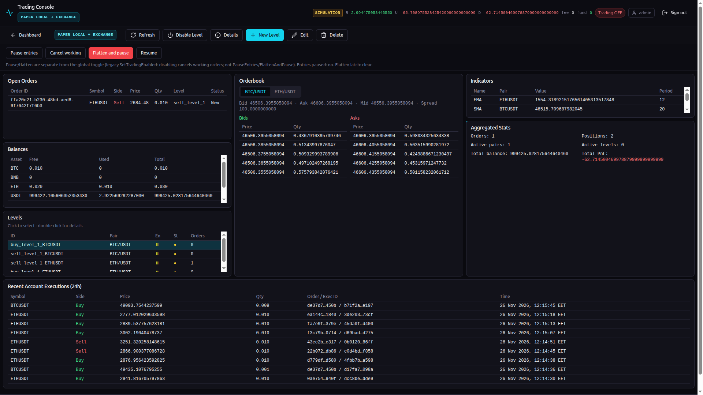
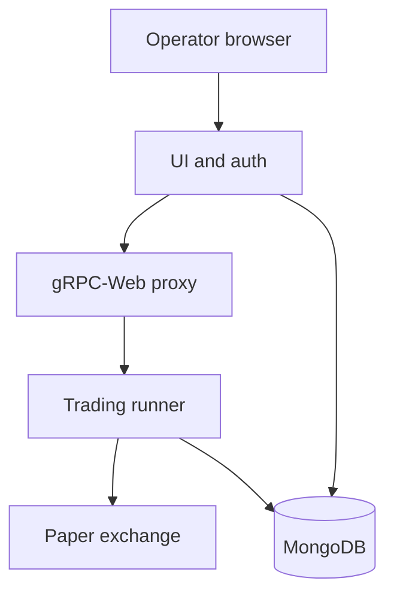

# Trading system showcase

Documentation, architecture diagrams, and a **loopback-only Paper laboratory** for the trading ecosystem. Apache License 2.0 — see [LICENSE](LICENSE) and [NOTICE](NOTICE). © 2026 T.L.P. Arc Entertainment Ltd.

This repository does **not** replace the implementation repos; it wires them for demos and qualification evidence.

## Purpose

- Explain how **trading_system**, **k-paper**, and **trading-system-ui** fit together.
- Provide **`lab/`** — supported Docker Compose path for Paper (runner + k-paper + UI on `127.0.0.1`).
- Collect honest capability and limitation notes (no production/mainnet claim; candidates ≠ validated alpha).

## Screenshot

Spot monitor in the Paper lab ([`screenshots/01-spot-monitor.png`](screenshots/01-spot-monitor.png)):



## Quick install (`lab/`)

Sibling layout (paths in `lab/.env.example` are relative to `lab/`):

```text
workspace/
├── trading_system/
├── k-paper/
├── trading-system-ui/
└── trading-system-showcase/
    └── lab/
```

```bash
cd lab && cp .env.example .env && make doctor && make build && make demo
```

- UI: http://127.0.0.1:5173  
- Runner health: http://127.0.0.1:8080/health  
- Trading **disabled** until enabled in the UI. Lab sign-in: `admin` / `admin` (change before any shared deploy).

```bash
make verify          # read-only readiness
make qualify         # trading_system paper gates
make scenario SCENARIO=normal-execution
make stop && make reset
```

Details: [lab/README.md](lab/README.md).

## Implementation repositories

| Repo | Role |
| --- | --- |
| [trading_system](https://github.com/Kolzodev712/trading_system) | Runner, engines, risk, gRPC gateway, research, Candidate #2 composition |
| [k-paper](https://github.com/Kolzodev712/k-paper) | Paper exchange server (HTTP/WS) |
| [trading-system-ui](https://github.com/Kolzodev712/trading-system-ui) | Browser operator console (gRPC-Web) |

Read **`trading_system`** [docs/ARCHITECTURE.md](https://github.com/Kolzodev712/trading_system/blob/main/docs/ARCHITECTURE.md) for authoritative wiring. Deep engine pages here may lag crate layout — prefer links over duplicating crate internals.

## Architecture (summary)

Operator browser → UI auth + Envoy gRPC-Web → **trading_system** runner → **k-paper** (Paper lab). MongoDB holds UI credentials and runner config persistence. In-process engines use broadcast channels; the UI never talks to k-paper directly.



More diagrams: [architecture/system-overview.md](architecture/system-overview.md) · [trading runner](architecture/trading-runner.md) · [paper exchange](architecture/paper-exchange.md) · [trading system UI](architecture/trading-system-ui.md).

## Verified capabilities (lab scope)

What **`lab/`** scenarios and `make qualify` are designed to exercise (not live-market performance):

| Area | Evidence |
| --- | --- |
| Paper order place / ACK / fill correlation | `normal-execution`, `just test-paper` |
| Partial fills, faults, reconnect drills | lab HTTP hooks + showcase scenarios |
| Operator pause / resume / trading toggle | `operator-control` |
| Risk block before send | `risk-rejection` |
| Health + structured logs | `observability` |

Scenario table: [lab/README.md](lab/README.md). Matrix across venues: trading_system [EXCHANGE_CAPABILITY_MATRIX.md](https://github.com/Kolzodev712/trading_system/blob/main/docs/EXCHANGE_CAPABILITY_MATRIX.md).

## Demo commands

From `lab/` after `make demo`:

```bash
make verify
make scenario SCENARIO=partial-fills
make scenario SCENARIO=reconciliation
make qualify
```

Recording notes: [demonstrations/video.md](demonstrations/video.md). Overview: [demonstrations/demonstration-overview.md](demonstrations/demonstration-overview.md).

## Limitations

- **Paper only** in `lab/`; config validation refuses live venue markers.
- Single in-memory paper account; restart loses venue state.
- Spot levels path in default demo; linear Candidate #2 gates live in `trading_system` + k-paper, not all showcase scenarios.
- No latency SLO or profitability claim. See [documentation/limitations.md](documentation/limitations.md).

## Contributing

See [CONTRIBUTING.md](CONTRIBUTING.md) and the ecosystem [ROADMAP.md](ROADMAP.md). Issues and doc fixes welcome here; implementation PRs usually belong in the component repositories. Update `lab/compatibility.json` when cutting a coordinated demo release.

## Professional services

T.L.P. Arc Entertainment Ltd. may offer integration review, custom venue adapters, and operator hardening beyond the public lab — contact via repository maintainer channels. The public `lab/` remains the supported self-serve onboarding path. No production/mainnet qualification is implied.

---

## Further reading (by topic)

| Topic | Doc |
| --- | --- |
| Problem statement | [documentation/](documentation/) (engineering decisions, reliability, testing) |
| Reliability | [documentation/reliability-and-recovery.md](documentation/reliability-and-recovery.md) |
| Testing methodology | [documentation/testing-methodology.md](documentation/testing-methodology.md) |
| Lab safety | [lab/README.md](lab/README.md) |

Legacy long-form component narratives below this line are being trimmed in favor of the architecture links above; if a section contradicts `lab/` or public repos, trust **`lab/`** and **trading_system** docs.

## Problem

An automated trader must keep market data, order commands, and operator control on separate paths and stay consistent when acknowledgements are late or sockets drop. The laboratory runs the same runner against local k-paper so those failures are cheap to repeat.

## Components (short)

| Component | Role |
| --- | --- |
| Market-data engine | Public book and trades from the venue session |
| Exchange engine | Orders, balances, exchange state, reconciliation |
| Trading engine | Levels/strategies execution, risk |
| Indicator engine | SMA/EMA for level pricing |
| Runner | Orchestration + gRPC |
| k-paper | Paper venue (separate process) |
| Browser UI | Monitoring and operator commands (separate repo) |

Candidate #2 composition (`btc_price_ma_app`) is optional for the default levels lab; see trading_system architecture.

## Technologies

Rust, Tokio, gRPC, MongoDB, WebSockets, React, Envoy (gRPC-Web). Optional Zenoh and DEX paths exist in trading_system but are **not** started by `lab/`.

## Engineering notes

Case studies: [documentation/engineering-decisions.md](documentation/engineering-decisions.md). Reliability: [documentation/reliability-and-recovery.md](documentation/reliability-and-recovery.md). Testing: [documentation/testing-methodology.md](documentation/testing-methodology.md).