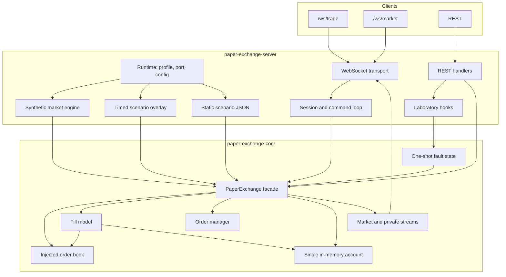

# Paper exchange

A separate process used as a laboratory venue. The core library has no sockets. The server wraps that core with HTTP, WebSocket, a synthetic market engine, optional scenarios, and one-shot fault hooks. It is a test double, not a copy of a production venue API.

## Surfaces

| Surface | Role |
| --- | --- |
| `/ws/market` | Order books and public trades |
| `/ws/trade` | Commands and private replies on the same connection |
| `GET /balances`, `/open_orders`, `/trades`, `/exchange_info`, `/positions` | Snapshots for bootstrap and reconciliation |
| `GET /orders/by_client_id/:id` | Lookup for a missing acknowledgement |
| `POST /test/*` | One-shot faults: disconnect, suppress ACK, reject, duplicate fill, stale book, partial fill, fail open-orders |

## Matching and account

- Incoming limits are checked against the current injected book.
- Resting user orders are not a multi-participant central book.
- Spot reservation locks quote on buy and base on sell.
- Default fill configuration does not slice fills. A laboratory hook can partially fill a resting order.
- A linear USDT-BTC fixture exists as a separate config. The demonstration uses the spot path.
- Process restart drops the in-memory account.

