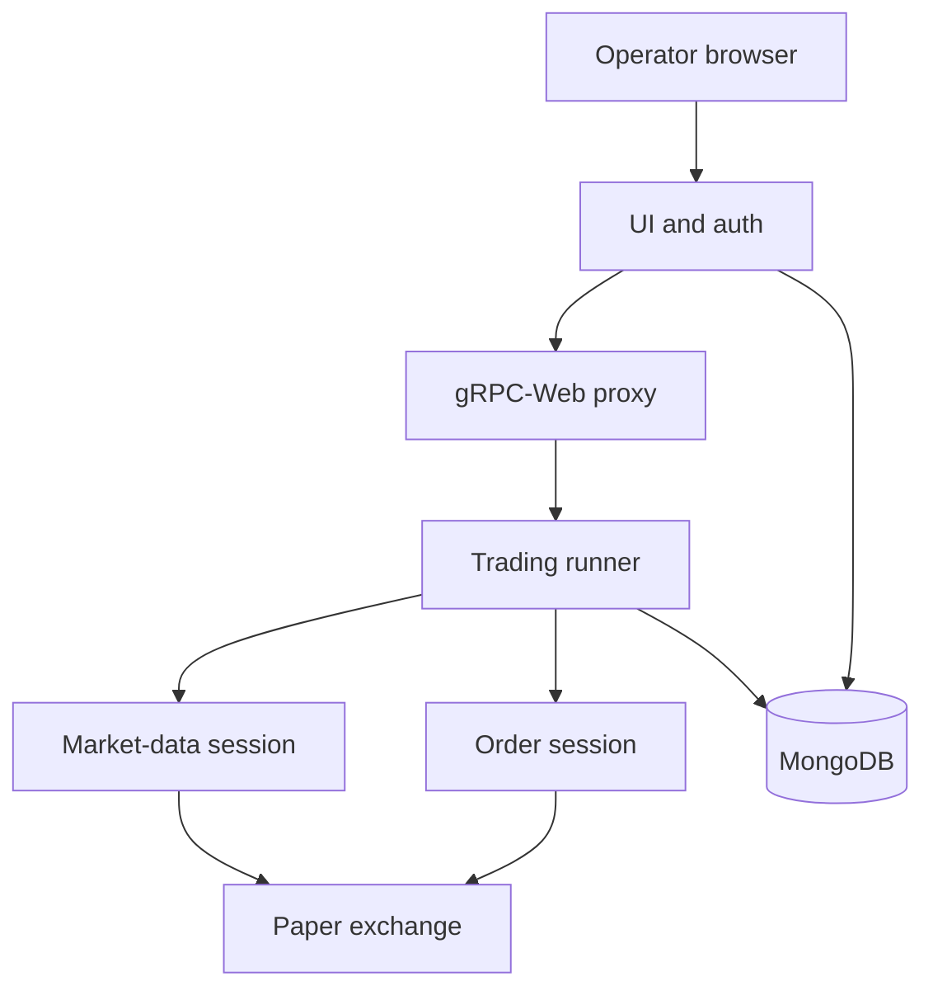
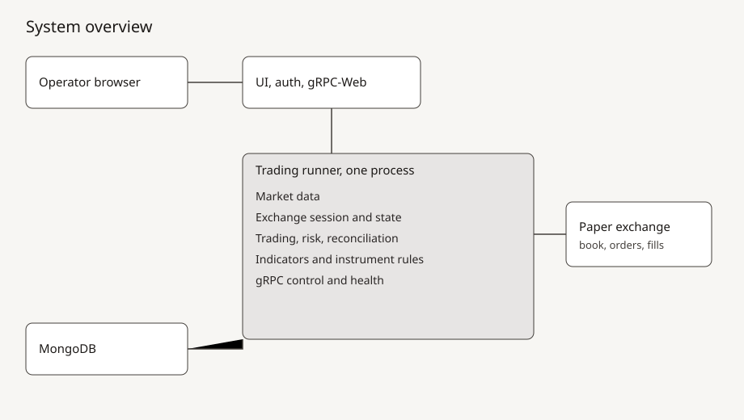
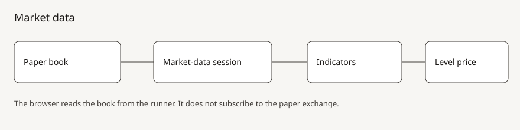
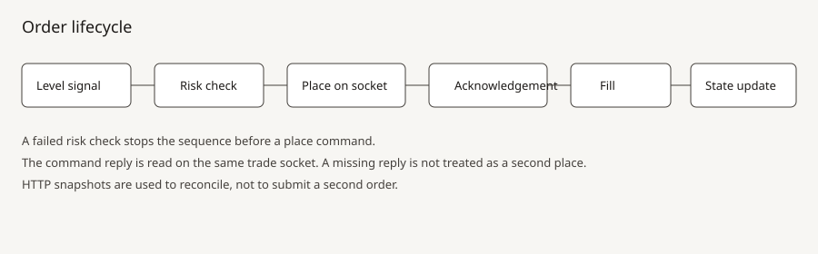
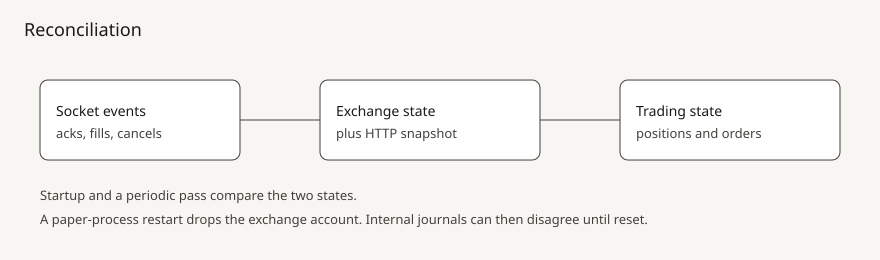

# System overview

The trading runner is one process. Market data, exchange state, indicators, risk, and order execution are modules inside it. They pass events on in-process channels.

The paper exchange is a second process. It owns the laboratory order book, balances, and fills. The runner is a client of that process over a WebSocket for commands, a WebSocket for market data, and HTTP for snapshots.

The browser is a third process group: a static UI, a small authentication service, and a gRPC-Web proxy. The UI never opens a connection to the paper exchange. Authentication is a demonstration login. It is not the exchange credential and it is not the authorization check used for non-paper venues.

MongoDB stores runner configuration and UI credentials. The levels runner requires it. Redis, an external message bus, and a trace collector are not part of this layout.

## Boundaries

| Boundary | What crosses it |
| --- | --- |
| Browser to proxy | gRPC-Web monitoring and operator commands |
| Proxy to runner | gRPC on the runner's control port |
| Runner to paper exchange | Market-data stream, order stream, HTTP snapshots |
| Runner to MongoDB | Configuration documents |
| Research tools | Do not share the live order path. They are separate binaries |

## Market data

The paper process publishes a synthetic book. The market-data session applies those updates inside the runner. Indicator values are computed from that stream. Level prices are bindings to those indicators, not constants typed into the order.

## Orders

A level that is enabled and has a price asks the trading engine for a risk check. If the check passes, the exchange session sends a place command on the trade socket and waits for the reply on that same socket. Fills and cancels update exchange state and trading state. HTTP snapshots are the reconciliation input, not a second order channel.

## Reconciliation

On startup, and later on a timer, the runner compares its trading state with the exchange state built from the socket and from HTTP. A mismatch in position or working orders is written back toward the exchange view. The demonstration checks that this bootstrap step runs. It does not claim a specific repaired incident unless that incident was produced and observed.

## Operator control

Pause, cancel working orders, flatten, and resume are gRPC calls. They do not travel on the market-data channel. Disabling entries is distinct from cancelling working orders. On a non-paper venue those mutating calls require an operator token at the proxy. The paper demonstration does not use a real venue, so it does not use that token.

## Per-system detail

- [Trading runner](trading-runner.md)
- [Paper exchange](paper-exchange.md)
- [Trading system UI](trading-system-ui.md)
