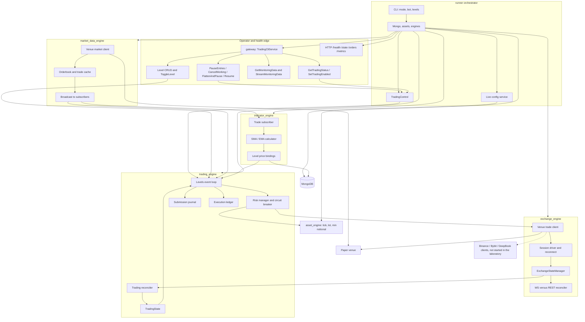

# Trading runner

One Rust process. Live CEX engines share that process and pass events on in-process broadcast channels. The laboratory demonstration starts `--mode levels` against the paper client. Other venue clients, strategy composition, and DEX mode exist in the tree and are marked below as not started in that demonstration.

## Boundaries that matter

| Path | What it carries |
| --- | --- |
| Market-data channel | Books and public trades inside the process |
| Trade WebSocket | Places, cancels, amends, and their replies on the same socket |
| HTTP to the venue | Balances, open orders, trades, exchange info, client-id lookup |
| gRPC | Monitoring and operator commands. Not market-data events |
| Journals | Local recovery material. Not venue truth |

## Laboratory path

- Exchange enum value: Paper.
- Indicator file path relative to the process working directory.
- Global trading starts disabled.
- Readiness stays failed until market data is fresh enough and the exchange snapshot is non-empty.
- The paper client allows one in-flight place, one cancel, and one amend.
- A composition binary can inject a research model into the same runner. That binary is not required for levels mode and is not started in the public demonstration.

