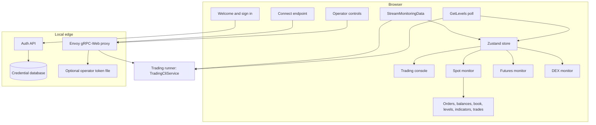

# Trading system UI

A browser operator console. It is a thin gRPC-Web client of the runner. It does not read `bot.json`, and it does not open a socket to the paper exchange or to a live venue.

## State and screens

| State | Source |
| --- | --- |
| Session | Auth API JWT |
| Venue and trading flags | `GetTradingStatus` |
| Live books, orders, balances, indicators | `StreamMonitoringData` about once a second |
| Levels | `GetLevels` on enter and on a short poll |

The console picks a monitor from the runner snapshot. Spot is the laboratory view. Futures and DEX monitors exist for other runner modes. Operator controls map to `PauseEntries`, `CancelWorking`, `FlattenAndPause`, `Resume`, and the legacy global trading switch. Login is a local demonstration session. It is not exchange authorization. On a non-paper venue the proxy can inject an operator token; the paper laboratory leaves that file empty.

